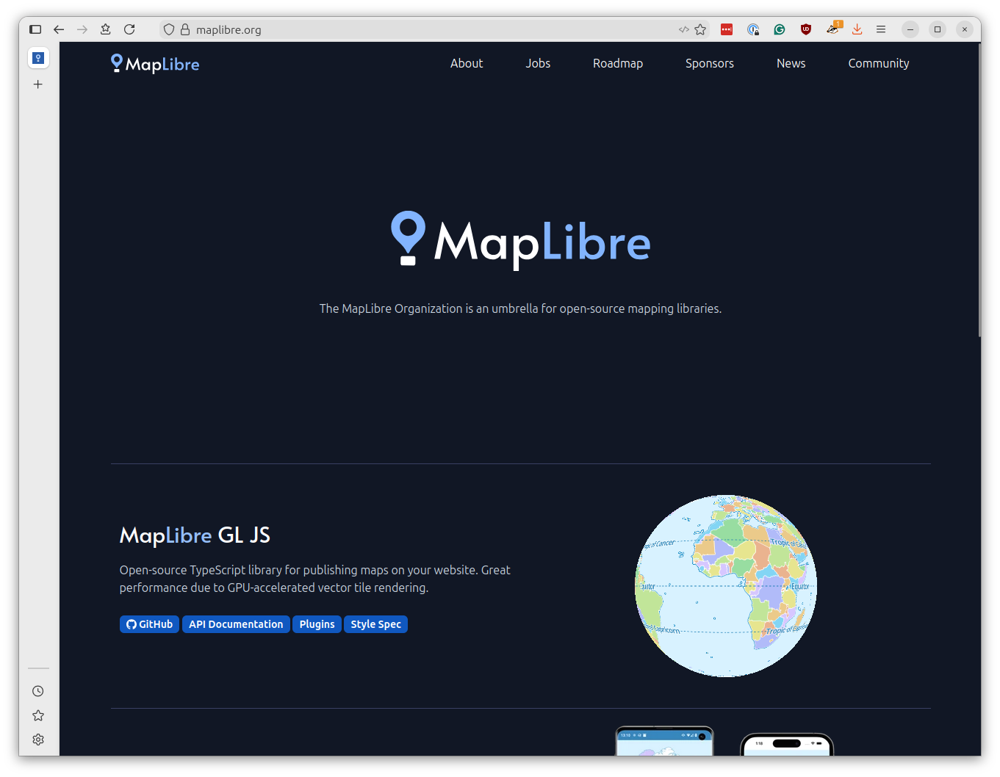
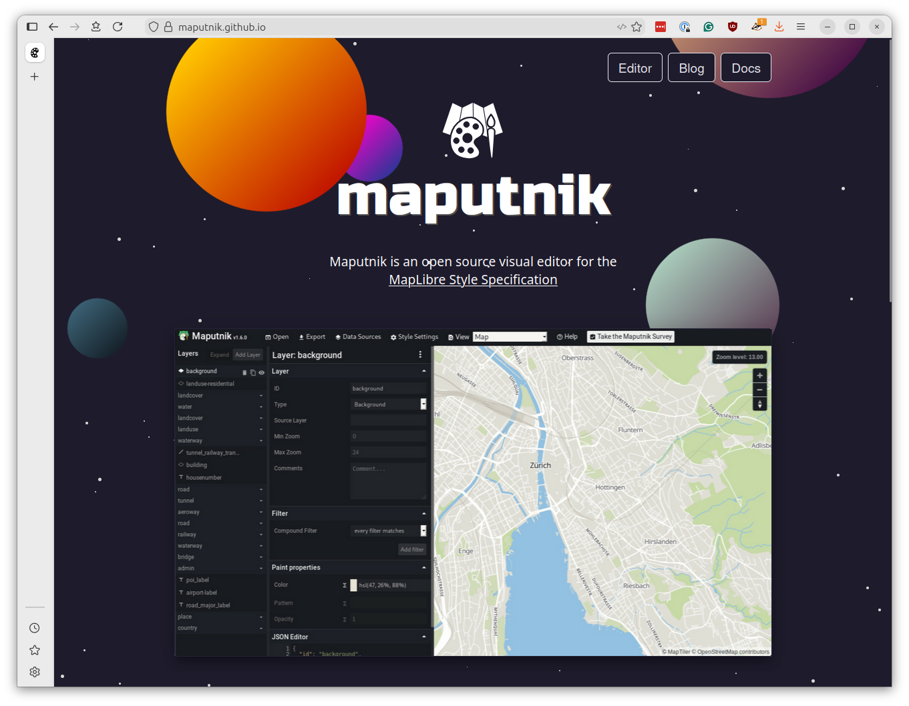
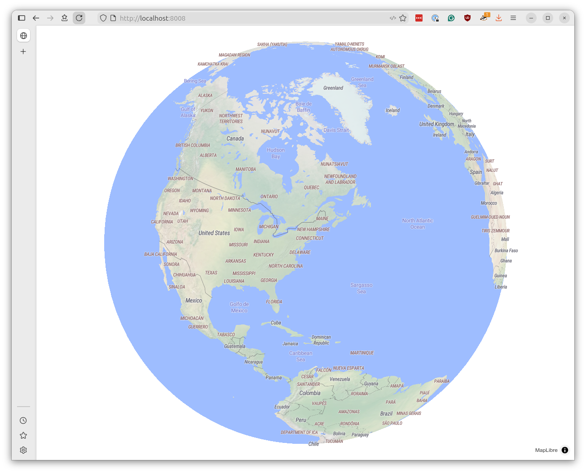
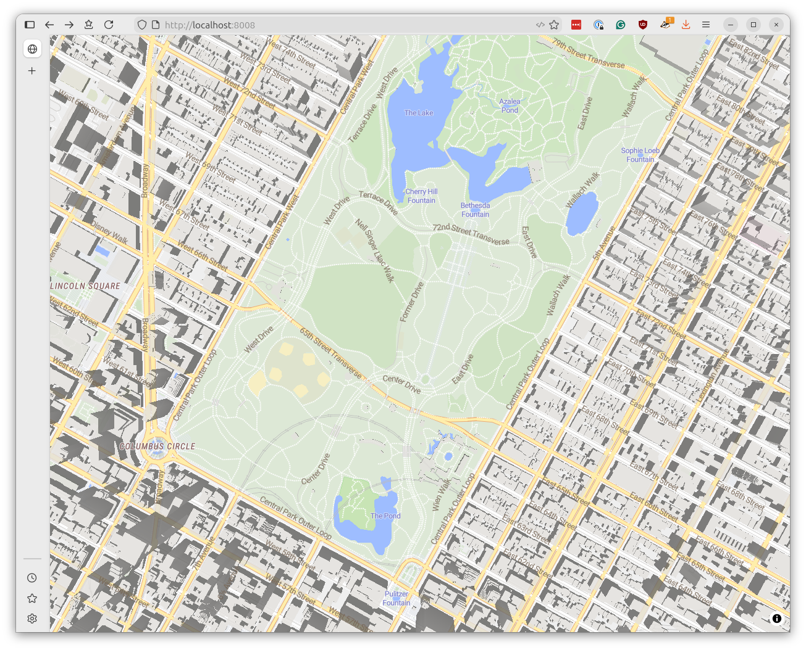

# Styling your basemap

Now that you've generated PMTiles files and uploaded them to S3, it's time to display them on a web page. We'll use [MapLibre GL JS](https://maplibre.org/maplibre-gl-js/docs/), an open-source library for rendering interactive maps in the browser.

[](https://maplibre.org/)

MapLibre displays maps by combining your basemap's data with a style file that defines how to present labels, colors, lines and the other visual elements that make up a map.

We created the PMTiles files in the previous chapter, but we still need a style file before we can draw it on the page.

You could write a style from scratch, like we did at Reuters for our custom basemap, but it's much easier to start with an existing one. A good on ramp is [OSM Liberty](https://github.com/maputnik/osm-liberty), an open-source style designed to fit the [OpenMapTiles](https://openmaptiles.org/) data schema, which is the same system that Planetiler produces.

OSM Liberty was created using [Maputnik](https://maputnik.github.io/), a free visual editor for MapLibre styles.

[](https://maputnik.github.io/)

You can use Maputnik to customize the look later. For now, you should start by downloading the [default OSM Liberty style](https://raw.githubusercontent.com/maputnik/osm-liberty/gh-pages/style.json), which will we will modify to point to your PMTiles files.

You can find it at:

```
https://raw.githubusercontent.com/maputnik/osm-liberty/gh-pages/style.json
```

Save the file as `style.json` in the root of your project directory. Open it up and find the `sources` section near the top. It will look something like this:

```json
  "sources": {
    "openmaptiles": {
      "type": "vector",
      "url": "https://api.maptiler.com/tiles/v3-openmaptiles/tiles.json?key={key}"
    },
    "natural_earth_shaded_relief": {
      "maxzoom": 6,
      "tileSize": 256,
      "tiles": [
        "https://klokantech.github.io/naturalearthtiles/tiles/natural_earth_2_shaded_relief.raster/{z}/{x}/{y}.png"
      ],
      "type": "raster"
    }
  },
```

Replace the URL with the base PMTiles URL created by your Actions workflow using the `pmtiles://` prefix

{emphasize-lines="4"}
```json
"sources": {
  "openmaptiles": {
    "type": "vector",
    "url": "pmtiles://https://your-bucket.s3.amazonaws.com/planet-TIMESTAMP-base.pmtiles"
  },
  "natural_earth_shaded_relief": {
    "maxzoom": 6,
    "tileSize": 256,
    "tiles": [
      "https://klokantech.github.io/naturalearthtiles/tiles/natural_earth_2_shaded_relief.raster/{z}/{x}/{y}.png"
    ],
    "type": "raster"
  }
}
```

The prefix tells MapLibre to use the [PMTiles protocol adapter](https://www.npmjs.com/package/pmtiles), which knows how to fetch tile data from a single PMTiles file using [HTTP range requests](https://developer.mozilla.org/en-US/docs/Web/HTTP/Guides/Range_requests).

To display 3D buildings, you need to add a second source for your buildings PMTiles file. Add the following block inside the `sources` section, below the existing `openmaptiles` source.

{emphasize-lines="6-9"}
```json
"sources": {
  "openmaptiles": {
    "type": "vector",
    "url": "pmtiles://https://your-bucket.s3.amazonaws.com/planet-TIMESTAMP-base.pmtiles"
  },
  "buildings": {
    "type": "vector",
    "url": "pmtiles://https://your-bucket.s3.amazonaws.com/planet-TIMESTAMP-buildings.pmtiles"
  },
  "natural_earth_shaded_relief": {
    "maxzoom": 6,
    "tileSize": 256,
    "tiles": [
      "https://klokantech.github.io/naturalearthtiles/tiles/natural_earth_2_shaded_relief.raster/{z}/{x}/{y}.png"
    ],
    "type": "raster"
  }
}
```

Scroll down and you'll see that the style file contains many layers, dictating how to present rivers, roads, parks, labels and buildings at different zoom levels. Each layer specifies which source it pulls data from using the `"source"` property. Most layers reference `"openmaptiles"`, but the building layers need to reference your new `"buildings"` source.

Search for layers with `"source-layer": "building"` in your style file. Edit the `"source"` property for these building layers points to your new source `"buildings"` and not `"openmaptiles"`.

{emphasize-lines="4,19"}
```json
{
  "id": "building",
  "type": "fill",
  "source": "buildings",
  "source-layer": "building",
  "minzoom": 13,
  "maxzoom": 14,
  "paint": {
    "fill-color": "hsl(35, 8%, 85%)",
    "fill-outline-color": {
      "base": 1,
      "stops": [[13, "hsla(35, 6%, 79%, 0.32)"], [14, "hsl(35, 6%, 79%)"]]
    }
  }
},
{
  "id": "building-3d",
  "type": "fill-extrusion",
  "source": "buildings",
  "source-layer": "building",
  "minzoom": 14,
  "paint": {
    "fill-extrusion-color": "hsl(35, 8%, 85%)",
    "fill-extrusion-height": {
      "property": "render_height",
      "type": "identity"
    },
    "fill-extrusion-base": {
      "property": "render_min_height",
      "type": "identity"
    },
    "fill-extrusion-opacity": 0.8
  }
},
```

:::{tip}
The `"source"` property tells MapLibre which tile source to read from, while `"source-layer"` specifies which layer *within* that source contains the data. Since our buildings PMTiles file has a layer called `"building"`, we set `"source": "buildings"` and `"source-layer": "building"`.
:::

Now let's create an HTML file that uses MapLibre to display our map. Create a new document named `index.html` and save it at the root of your project directory. Copy and paste the following code into it:

{emphasize-lines="17-18,22"}
```html
<!DOCTYPE html>
<html>
<head>
    <meta charset="utf-8">
    <title>My First Basemap</title>
    <script src="https://unpkg.com/maplibre-gl@5.15.0/dist/maplibre-gl.js"></script>
    <link href="https://unpkg.com/maplibre-gl@5.15.0/dist/maplibre-gl.css" rel="stylesheet">
    <script src="https://unpkg.com/pmtiles@4.3.0/dist/pmtiles.js"></script>
    <style>
        body { margin: 0; }
        #map { width: 100vw; height: 100vh; }
    </style>
</head>
<body>
    <div id="map"></div>
    <script>
        let protocol = new pmtiles.Protocol();
        maplibregl.addProtocol('pmtiles', protocol.tile);

        const map = new maplibregl.Map({
            container: 'map',
            style: 'style.json',
            center: [-73.9, 40.7],
            zoom: 2.5,
            maxZoom: 15
        });

        map.on('load', () => {
            map.setProjection({ type: 'globe' });
        });
    </script>
</body>
</html>
```

This is mostly boilerplate MapLibre code, with two important additions.

The first set of highlighted lines register the PMTiles protocol with MapLibre. This is required for the `pmtiles://` URLs in your style file to work.

The second highlight is the style property in the map configuration, which directs MapLibre to use the `style.json` file you just modified.

To test your map, open a terminal in your project directory and start a simple HTTP server to serve your files.

If you have Python installed, the easiest method is:

```bash
python -m http.server 8000
```

Then open `http://localhost:8000` in your browser. You should see your basemap rendered as an interactive globe.



Zoom in close enough and you should see 3D buildings popping up in major cities.



Congratulations! You've created an interactive map using your PMTiles basemap and MapLibre GL JS. What you do with it from here is up to you. If you're looking for a challenge, try customizing the style using [Maputnik](https://maputnik.github.io/) or adding a data layer on top of your basemap using GeoJSON.

You can also start adding other datasets. Here's an example that layers on population density contours from [WorldPop](https://www.worldpop.org/) as a PMTiles file after the data is compiled via [Tippecanoe](https://docs.protomaps.com/pmtiles/create).


```{raw} html
<div style="width: 100%; height: 400px; position: relative;">
    <div id="demo-map" style="position: absolute; top: 0; bottom: 0; left: 0; right: 0;"></div>
</div>
<script src="https://unpkg.com/maplibre-gl@5.15.0/dist/maplibre-gl.js"></script>
<script src="https://unpkg.com/pmtiles@3/dist/pmtiles.js"></script>
<link href="https://unpkg.com/maplibre-gl@5.15.0/dist/maplibre-gl.css" rel="stylesheet">
<script>
    // Register PMTiles protocol with MapLibre
    let protocol = new pmtiles.Protocol();
    maplibregl.addProtocol('pmtiles', protocol.tile);

    // Create the map
    const map = new maplibregl.Map({
        container: 'demo-map',
        style: '_static/style.json',
        center: [-98.5795, 25],
        zoom: 1.5,
        minZoom: 1.5,
        maxZoom: 1.5,
        attributionControl: false,
        interactive: false
    });

   // Globe rotation
    function createGlobeSpinner(map, degreesPerSecond = 10) {
        let animationId = null;
        let lastTime;

        function spin() {
            const now = performance.now();
            const elapsed = (now - lastTime) / 1000;
            lastTime = now;

            const center = map.getCenter();
            center.lng += degreesPerSecond * elapsed;
            map.setCenter(center);

            animationId = requestAnimationFrame(spin);
        }

        return {
            start() {
                if (!animationId) {
                    lastTime = performance.now();
                    spin();
                }
            },
            stop() {
                if (animationId) {
                    cancelAnimationFrame(animationId);
                    animationId = null;
                }
            }
        };
    }

    // Start spinning once the map is ready
    map.on('load', () => {
        map.setProjection({ type: 'globe' });
        const spinner = createGlobeSpinner(map);
        spinner.start();

        map.addSource('population-contours', {
          type: 'vector',
          url: 'pmtiles://https://first-basemap.s3.amazonaws.com/worldpop_global_2020_contour_polygons.pmtiles',
        });

        // Find the first label layer to insert below, so labels stay on top of data
        const firstLabelLayer = map.getStyle().layers.find(layer => layer.type === 'symbol')


        // Filled polygons with color ramp based on floor value
        map.addLayer({
          id: 'population-fill',
          type: 'fill',
          source: 'population-contours',
          'source-layer': 'population',
          paint: {
            'fill-color': [
              'step',
              ['get', 'floor'],
              '#fdd49e',    // 100-500: Muted orange (good contrast with gray)
              500,    '#fdbb84',  // 500-1k
              1000,   '#fc8d59',  // 1k-2.5k
              2500,   '#ef6548',  // 2.5k-5k
              5000,   '#d7301f',  // 5k-10k
              10000,  '#b30000',  // 10k-25k
              25000,  '#9e0000',  // 25k-50k
              50000,  '#7f0000',  // 50k-100k
              100000, '#650000',  // 100k-250k
              250000, '#4d0000',  // 250k-500k
              500000, '#330000'   // 500k-1M+
            ],
            'fill-opacity': 0.85
          },
          // Insert below first label layer to keep labels on top
        }, firstLabelLayer ? firstLabelLayer.id : undefined);
    });
</script>
```

We won't cover all the steps in that process here, but once you have a PMTiles data layer ready, you can add it to your map using [MapLibre's standard techniques](https://maplibre.org/maplibre-gl-js/docs/examples/add-a-new-layer-below-labels/).

{emphasize-lines="8-9"}
```js
map.on('load', () => {
  // Here's how you get that nice globe
  map.setProjection({ type: 'globe' });

  // Add your PMTiles data source as an extra layer on top of the base map
  map.addSource('your-dataset', {
    type: 'vector',
    // Note that we're using the pmtiles:// prefix here again
    url: 'pmtiles://https://your-bucket.s3.amazonaws.com/your-dataset.pmtiles',
  });

  // Find the first label layer to insert below, so labels stay on top of data
  const firstLabelLayer = map.getStyle().layers.find(layer => layer.type === 'symbol')

  // Define how to render your data; here's an example for filled polygons
  map.addLayer({
    id: 'data-layer-fill',
    type: 'fill',
    source: 'your-dataset',
    'source-layer': 'your-data-layer',
    paint: {
      // This bit will depend on your data; here's an example color ramp
      // tailored for population density contours
      'fill-color': [
        'step',
        ['get', 'floor'],
          '#fdd49e',          // 100-500
          500,    '#fdbb84',  // 500-1k
          1000,   '#fc8d59',  // 1k-2.5k
          2500,   '#ef6548',  // 2.5k-5k
          5000,   '#d7301f',  // 5k-10k
          10000,  '#b30000',  // 10k-25k
          25000,  '#9e0000',  // 25k-50k
          50000,  '#7f0000',  // 50k-100k
          100000, '#650000',  // 100k-250k
          250000, '#4d0000',  // 250k-500k
          500000, '#330000'   // 500k-1M+
        ],
        'fill-opacity': 0.85
      },
      // Insert below first label layer to keep labels on top
    }, firstLabelLayer ? firstLabelLayer.id : undefined);
});
```

```{tip}
If you'd like to learn how to deploy your map to the web using [GitHub Pages](https://docs.github.com/en/pages), another powerful GitHub service, you might enjoy our related lesson, ["Go big with GitHub Actions."](https://palewi.re/docs/go-big-with-github-actions/deploy.html)
```
