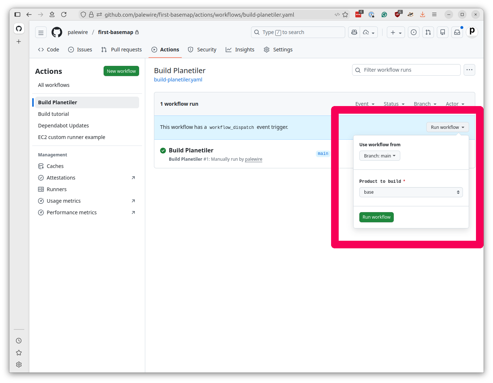
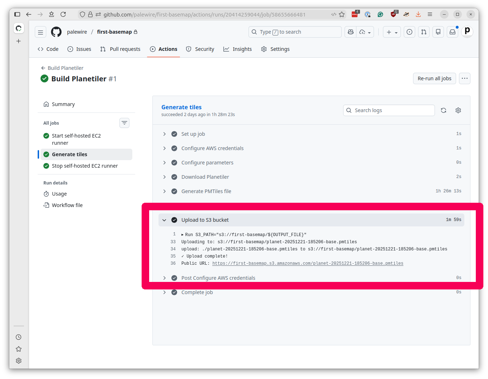

# Building your PMTiles

Now that we have configured our AWS account and learned how to create custom EC2 runners with GitHub Actions, we're ready to put everything together and build our global basemap.

To do that, we'll need to take advantage of another open-source tool.

## What is Planetiler?

[Planetiler](https://github.com/onthegomap/planetiler) is a [Java](https://en.wikipedia.org/wiki/Java_(programming_language)) application that can convert massive amounts of geographic data into the PMTiles file format. It was created by [Michael Barry](https://github.com/msbarry), who designed it to process the entire OpenStreetMap planet file in just a few hours.


The tool offers [extensive configuration options](https://github.com/onthegomap/planetiler/blob/main/config-example.properties) that control which map features are included, how they are handled at different zoom levels and other settings. That makes it possible to create different types of maps optimized for different use cases. Some developers use it to create highly customized maps limited to small areas, while others, like us, use it to create general-purpose basemaps of the entire world.

## Why we need EC2

GitHub's standard Actions runners have fairly limited resources, and they're not allowed to run longer than six hours. While that might be suitable for most tasks, it's simply not enough power for this job.

Planetiler needs lots of RAM to efficiently process the full planet file, multiple high-speed CPUs to parallelize the work and hundreds of gigabytes of fast disk space for temporary files. Given enough resources, it can map out the planet in a few hours, but on a small server that same task could take days or even weeks.

## Creating the Planetiler workflow

Let's start by creating a new workflow file that will build our basemap files. Create a new file in your repository called `.github/workflows/build-planetiler.yaml`.

We'll start with the familiar pattern from the previous chapter and gradually add the Planetiler-specific features.

First, let's set up the basic workflow structure. This time, we'll add a new feature: a `choice` input to the `workflow_dispatch` setting that allows you to select from two different map products to build.

```yaml
name: Build Planetiler

on:
  workflow_dispatch:
    inputs:
      product:
        description: 'Product to build'
        required: true
        type: choice
        options:
          - base       # A basemap without buildings and with more aggressive simplification
          - buildings  # A buildings-only layer with minimal simplification
```

This will create a dropdown menu in the GitHub Actions interface that you will use to configure Planetiler's parameters and build two different PMTiles files using the same workflow.

The two products are:

* <b>`base`</b>: A complete basemap that includes everything except building footprints, which allows Planetiler to use aggressive simplification methods to reduce the number of points in complex borders, rivers and streets to keep the file size down
* <b>`buildings`</b>: A layer containing only building footprints with minimal simplification to preserve the detail of buildings at high zoom levels

We developed this two-layer approach at Reuters to balance performance and detail. The `base` layer provides a fast-loading overview of the world, while the `buildings` layer adds rich detail where needed.

Next, add the environment variables that configure our AWS and EC2 settings.

{emphasize-lines="5-7,12"}
```yaml
# Customize these values for your environment
env:
  # AWS
  AWS_REGION: us-east-1
  AWS_SUBNET_ID: your-subnet-id-here
  AWS_SECURITY_GROUP_ID: your-security-group-id-here
  AWS_S3_BUCKET_NAME: your-unique-bucket-name-here

  # EC2
  EC2_IMAGE_ID: ami-0e86e20dae9224db8   # Ubuntu 24.04 LTS
  EC2_INSTANCE_TYPE: r5d.8xlarge        # 32 vCPUs, 256 GB RAM, 2x600 GB NVMe SSD
  EC2_VOLUME_SIZE: 1000                 # Root volume size in GB
```

 You should customize the `AWS_SUBNET_ID` and `AWS_SECURITY_GROUP_ID` values to match your AWS setup as in the previous chapter.

 The `AWS_S3_BUCKET_NAME` is a new setting where you should place the name of the file hosting bucket where PMTiles files will be stored. This will need to be something unique across all AWS users, so consider using a name that incorporates your GitHub username or your organization's name.

You can keep the EC2 settings as is. We know they'll work. But notice that we've bumped up the `EC2_VOLUME_SIZE` to 1,000 gigabytes. Planetiler needs a lot of disk space for temporary files, so we're giving it more room to work.

Create the first job, which starts our EC2 runner. This should look familiar from the previous chapter, with some important additions in the `pre-runner-script` section.

{emphasize-lines="27-48"}
```yaml
jobs:
  start-runner:
    name: Start self-hosted EC2 runner
    runs-on: ubuntu-latest
    outputs:
      label: ${{ steps.start-ec2-runner.outputs.label }}
      ec2-instance-id: ${{ steps.start-ec2-runner.outputs.ec2-instance-id }}
    steps:
      - name: Configure AWS credentials
        uses: aws-actions/configure-aws-credentials@v5
        with:
          aws-access-key-id: ${{ secrets.AWS_ACCESS_KEY_ID }}
          aws-secret-access-key: ${{ secrets.AWS_SECRET_ACCESS_KEY }}
          aws-region: ${{ env.AWS_REGION }}

      - name: Start EC2 runner
        id: start-ec2-runner
        uses: machulav/ec2-github-runner@v2.4.2
        with:
          mode: start
          github-token: ${{ secrets.GH_PERSONAL_ACCESS_TOKEN }}
          ec2-image-id: ${{ env.EC2_IMAGE_ID }}
          ec2-instance-type: ${{ env.EC2_INSTANCE_TYPE }}
          ec2-volume-size: ${{ env.EC2_VOLUME_SIZE }}
          subnet-id: ${{ env.AWS_SUBNET_ID }}
          security-group-id: ${{ env.AWS_SECURITY_GROUP_ID }}
          pre-runner-script: |
            # Update system
            sudo apt-get update -y

            # Install required packages
            sudo apt-get install -y git libicu-dev unzip curl nvme-cli openjdk-21-jdk-headless

            # Download and install AWS CLI v2
            curl "https://awscli.amazonaws.com/awscli-exe-linux-x86_64.zip" -o "awscliv2.zip"
            unzip awscliv2.zip
            sudo ./aws/install

            # Clean up installation files
            rm -rf aws awscliv2.zip

            # Setup NVMe instance storage
            if lsblk | grep -q nvme1n1; then
              sudo mkfs.xfs /dev/nvme1n1
              sudo mkdir -p /mnt/planetiler
              sudo mount /dev/nvme1n1 /mnt/planetiler
              sudo chmod 777 /mnt/planetiler
            fi
```

The server is seeded with the Java programming language required by Planetiler, as well as the [AWS command-line interface](https://aws.amazon.com/cli/) needed to upload the finished tiles to S3. We've also included a trick that configures the server to use faster [NVMe storage](https://en.wikipedia.org/wiki/NVM_Express) for reading and writing files.

Now our main event: the job that generates the map tiles. Let's add it piece by piece.

First, the job configuration:

```yaml
  generate-tiles:
    name: Generate tiles
    needs: start-runner
    runs-on: ${{ needs.start-runner.outputs.label }}
    timeout-minutes: 240  # Four hours
```

This time the `timeout-minutes` is set to 240 minutes, or four hours, which should be enough time for Planetiler to process the planet file.

The first step configures AWS credentials, just like before.

{emphasize-lines="6-12"}
```yaml
  generate-tiles:
    name: Generate tiles
    needs: start-runner
    runs-on: ${{ needs.start-runner.outputs.label }}
    timeout-minutes: 240  # Four hours
    steps:
      - name: Configure AWS credentials
        uses: aws-actions/configure-aws-credentials@v5
        with:
          aws-access-key-id: ${{ secrets.AWS_ACCESS_KEY_ID }}
          aws-secret-access-key: ${{ secrets.AWS_SECRET_ACCESS_KEY }}
          aws-region: ${{ env.AWS_REGION }}
```

Now we configure the simplification and zoom parameters based on which product was selected.

The `base` product uses more aggressive simplification to reduce file size, while the `buildings` product uses minimal simplification to preserve detail.

The `base` product includes all zoom levels from 0 to 15, while the `buildings` product only includes zoom levels 13-15 where buildings are visible.

```yaml
      - name: Configure parameters
        run: |
          # Set simplification parameters based on selected profile
          case "${{ inputs.product }}" in
            'buildings')
              echo "Using the default simplification profile for a building layer"
              SIMPLIFY_TOLERANCE="0.1"
              SIMPLIFY_TOLERANCE_MAX_ZOOM="0.0625"
              MIN_FEATURE_SIZE="1.0"
              MIN_FEATURE_SIZE_MAX_ZOOM="0.0625"
              MIN_ZOOM=13
              MAX_ZOOM=15
              ;;
            'base')
              echo "Using a more aggressive simplification profile for a basemap layer without buildings"
              SIMPLIFY_TOLERANCE="0.4"
              SIMPLIFY_TOLERANCE_MAX_ZOOM="0.3"
              MIN_FEATURE_SIZE="1.5"
              MIN_FEATURE_SIZE_MAX_ZOOM="0.5"
              MIN_ZOOM=0
              MAX_ZOOM=15
              ;;
             *)
              echo "Error: Unknown product '${{ inputs.product }}'"
              exit 1
              ;;
          esac

          # Export to GitHub environment for next steps
          echo "SIMPLIFY_TOLERANCE=$SIMPLIFY_TOLERANCE" >> $GITHUB_ENV
          echo "SIMPLIFY_TOLERANCE_MAX_ZOOM=$SIMPLIFY_TOLERANCE_MAX_ZOOM" >> $GITHUB_ENV
          echo "MIN_FEATURE_SIZE=$MIN_FEATURE_SIZE" >> $GITHUB_ENV
          echo "MIN_FEATURE_SIZE_MAX_ZOOM=$MIN_FEATURE_SIZE_MAX_ZOOM" >> $GITHUB_ENV
          echo "MIN_ZOOM=$MIN_ZOOM" >> $GITHUB_ENV
          echo "MAX_ZOOM=$MAX_ZOOM" >> $GITHUB_ENV

          # Display simplification parameters
          echo ""
          echo "=== Simplification Parameters ==="
          echo "Simplify tolerance: $SIMPLIFY_TOLERANCE"
          echo "Simplify tolerance at max zoom: $SIMPLIFY_TOLERANCE_MAX_ZOOM"
          echo "Min feature size: $MIN_FEATURE_SIZE"
          echo "Min feature size at max zoom: $MIN_FEATURE_SIZE_MAX_ZOOM"
          echo "Min zoom: $MIN_ZOOM"
          echo "Max zoom: $MAX_ZOOM"
          echo "===================="
```

The variables are exported to `$GITHUB_ENV`, which makes them available to all subsequent steps in the job.

```{note}
These settings were developed by our Reuters team through an iterative process of trial and error. As with all design, your judgement may differ. You should feel free to adjust the parameters to suit your own needs and preferences. Making a new map is as easy as changing a few numbers and re-running the workflow.
```

The next step downloads the latest version of Planetiler from GitHub by scraping the releases API to find the most recent JAR file.

```yaml
      - name: Download Planetiler
        working-directory: /mnt/planetiler
        run: |
          echo "Downloading latest Planetiler..."

          # Scrape latest release download URL from GitHub API
          LATEST_URL=$(curl -s https://api.github.com/repos/onthegomap/planetiler/releases/latest \
            | grep browser_download_url | head -1 | grep -E "planetiler.jar" | cut -d '"' -f 4)
          echo "Download URL: $LATEST_URL"

          # Download Planetiler JAR
          curl -L -o planetiler.jar "$LATEST_URL"

          # Verify download
          java -jar planetiler.jar --help > /dev/null
          echo "✓ Planetiler downloaded successfully"
```

The `working-directory: /mnt/planetiler` tells this step to run in our fast NVMe storage directory. The verification step runs `--help` to make sure Java can execute Planetiler properly.

Now the core step that generates the map tiles. It begins by gradually constructing the command line statement that will kickstart Planetiler based on the selected parameters.

```yaml

      - name: Generate PMTiles file
        working-directory: /mnt/planetiler
        run: |
          TIMESTAMP=$(date +%Y%m%d-%H%M%S)
          OUTPUT_FILE="planet-${TIMESTAMP}-${{ inputs.product }}.pmtiles"

          # Build Planetiler command, starting with Java invocation and configuration of memory
          PLANETILER_CMD="java -Xmx200g -XX:MaxHeapFreeRatio=40 -jar planetiler.jar"

          # Configure data source
          PLANETILER_CMD="$PLANETILER_CMD --area=planet --bounds=world --download"
          PLANETILER_CMD="$PLANETILER_CMD --download-threads=10 --download-chunk-size-mb=1000"

          # Limit languages to English for smaller size
          PLANETILER_CMD="$PLANETILER_CMD --languages=en"

          # Add simplification parameters
          PLANETILER_CMD="$PLANETILER_CMD --simplify-tolerance=$SIMPLIFY_TOLERANCE"
          PLANETILER_CMD="$PLANETILER_CMD --simplify-tolerance-at-max-zoom=$SIMPLIFY_TOLERANCE_MAX_ZOOM"
          PLANETILER_CMD="$PLANETILER_CMD --min-feature-size=$MIN_FEATURE_SIZE"
          PLANETILER_CMD="$PLANETILER_CMD --min-feature-size-at-max-zoom=$MIN_FEATURE_SIZE_MAX_ZOOM"

          # Add remaining options
          PLANETILER_CMD="$PLANETILER_CMD --fetch-wikidata"
          PLANETILER_CMD="$PLANETILER_CMD --output=$OUTPUT_FILE"
          PLANETILER_CMD="$PLANETILER_CMD --nodemap-type=array"
          PLANETILER_CMD="$PLANETILER_CMD --storage=ram"
          PLANETILER_CMD="$PLANETILER_CMD --min-zoom=$MIN_ZOOM"
          PLANETILER_CMD="$PLANETILER_CMD --max-zoom=$MAX_ZOOM"

          # Skip building merge if requested
          if [ "${{ inputs.product }}" == "base" ]; then
            PLANETILER_CMD="$PLANETILER_CMD --building-merge-z13=false"
          fi

          # Set feature layers based on product
          if [ "${{ inputs.product }}" == "buildings" ]; then
            PLANETILER_CMD="$PLANETILER_CMD --only-layers=building"
          else
            PLANETILER_CMD="$PLANETILER_CMD --exclude-layers=housenumber,building,poi"
          fi

          echo ""
          echo "=== Starting Planetiler ==="
          echo "Command: $PLANETILER_CMD"
          echo "==========================="
          echo ""

          # Run Planetiler
          $PLANETILER_CMD 2>&1 | tee planetiler.log

          # Verify output
          if [ ! -f "$OUTPUT_FILE" ]; then
            echo "✗ Output file not created"
            exit 1
          fi

          FILE_SIZE=$(stat -c%s "$OUTPUT_FILE")
          if [ "$FILE_SIZE" -lt 1000000 ]; then
            echo "✗ Output file too small (${FILE_SIZE} bytes) - generation likely failed"
            tail -100 planetiler.log
            exit 1
          fi

          echo "✓ Planet tiles generated successfully!"
          ls -lh "$OUTPUT_FILE"
          echo "OUTPUT_FILE=$OUTPUT_FILE" >> $GITHUB_ENV
```

This is a complex operation that includes technical details that aren't worth diving into here. But there are several key customizations that you may want to adjust to fit your needs.

The `TIMESTAMP` setting is combined with the product name to create a unique `OUTPUT_FILE` setting for each run. This prevents overwriting previous files and makes it easy to track builds over time. However, if you prefer a consistent filename, you could replace this with a fixed path like `planet-${{ inputs.product }}.pmtiles` or another pattern that you prefer.

```{note}
The OpenStreetMap database, drawn from volunteers and public data sources around the world, is constantly changing. When you run Planetiler, it will generate a new PMTiles file that reflects the most recent data.

If you're going to integrate this workflow into a production system, you should consider keeping your basemap up to date by running this workflow periodically. The filename pattern may need to be adjusted to fit your versioning strategy.
```

The `--languages=en` flag means that Planetiler will include only English names to reduce file size. You could add more with `--languages=en,es,fr`, if you preferred, or omit the flag entirely to include all available languages.

The `--exclude-layers=housenumber,building,poi` flag for the `base` product removes not just building footprints but also house numbers and the massive database of [points of interest packaged with OpenStreetMap](https://wiki.openstreetmap.org/wiki/Points_of_interest). This helps keep the file size down for a general-purpose basemap. However, if you wanted to style and include points of interest, you should remove `poi` from the exclusion list.

```{note}
All of the command-line options are documented in the [Planetiler](https://github.com/onthegomap/planetiler/blob/main/config-example.properties) repository. You can customize these settings further to suit your project.
```

Once that lengthy process is complete, we will need to upload the finished PMTiles file to our S3 bucket. But first, we need to ensure the bucket exists and is configured correctly.

```yaml
      - name: Ensure S3 bucket exists
        run: |
          BUCKET="${{ env.AWS_S3_BUCKET_NAME }}"

          if ! aws s3api head-bucket --bucket "$BUCKET" 2>/dev/null; then
            echo "Creating bucket $BUCKET..."
            if [ "${{ env.AWS_REGION }}" = "us-east-1" ]; then
              aws s3api create-bucket --bucket "$BUCKET"
            else
              aws s3api create-bucket \
                --bucket "$BUCKET" \
                --create-bucket-configuration LocationConstraint=${{ env.AWS_REGION }}
            fi
            echo "✓ Bucket created"
          else
            echo "✓ Bucket already exists"
          fi

          # Disable Block Public Access
          echo "Configuring public access settings..."
          aws s3api put-public-access-block \
            --bucket "$BUCKET" \
            --public-access-block-configuration \
            "BlockPublicAcls=false,IgnorePublicAcls=false,BlockPublicPolicy=false,RestrictPublicBuckets=false"

          # Add public read policy
          echo "Applying public read policy..."
          cat > /tmp/bucket-policy.json << EOF
          {
            "Version": "2012-10-17",
            "Statement": [
              {
                "Sid": "PublicReadGetObject",
                "Effect": "Allow",
                "Principal": "*",
                "Action": "s3:GetObject",
                "Resource": "arn:aws:s3:::${BUCKET}/*"
              }
            ]
          }
          EOF

          aws s3api put-bucket-policy --bucket "$BUCKET" --policy file:///tmp/bucket-policy.json
          echo "✓ Public access configured"

          # Add CORS configuration
          echo "Configuring CORS..."
          cat > /tmp/cors.json << EOF
          {
            "CORSRules": [{
              "AllowedOrigins": ["*"],
              "AllowedMethods": ["GET", "HEAD"],
              "AllowedHeaders": ["*"],
              "MaxAgeSeconds": 3600
            }]
          }
          EOF
          aws s3api put-bucket-cors --bucket "$BUCKET" --cors-configuration file:///tmp/cors.json
          echo "✓ CORS configured"
```

This step looks to see if the bucket is already there, and creates it if not. It also allows for public access over the web and configures the file to allow for [cross-origin resource sharing](https://developer.mozilla.org/en-US/docs/Web/HTTP/Guides/CORS) so that any web page can access the tiles. If you want to limit access to your tiles, you should modify these settings accordingly.

Finally, we upload the finished tiles.

```yaml
      - name: Upload to S3 bucket
        working-directory: /mnt/planetiler
        run: |
          S3_PATH="s3://${{ env.AWS_S3_BUCKET_NAME }}/${OUTPUT_FILE}"
          echo "Uploading to: $S3_PATH"

          # Upload with metadata and caching headers, which will tell CDNs to cache for 1 day
          aws s3 cp "$OUTPUT_FILE" "$S3_PATH" \
            --storage-class INTELLIGENT_TIERING \
            --cache-control "public, max-age=86400" \
            --metadata "github-run=${{ github.run_id }},product=${{ inputs.product }}" \
            --no-progress

          echo "✓ Upload complete!"
          echo "Public URL: https://${{ env.AWS_S3_BUCKET_NAME }}.s3.amazonaws.com/${OUTPUT_FILE}"
```

The upload sets a day-long cache and packages some metadata for tracking purposes. At the end it will print the public URL where the tiles can be accessed.

Finally, we need to shut down the EC2 instance with a third step, just as in the previous chapter. Note that we've changed the `needs` clause to include the new `generate-tiles` job.

{emphasize-lines="5"}
```yaml
  stop-runner:
    name: Stop self-hosted EC2 runner
    needs:
      - start-runner
      - generate-tiles
    runs-on: ubuntu-latest
    if: ${{ always() }}
    steps:
      - name: Configure AWS credentials
        uses: aws-actions/configure-aws-credentials@v5
        with:
          aws-access-key-id: ${{ secrets.AWS_ACCESS_KEY_ID }}
          aws-secret-access-key: ${{ secrets.AWS_SECRET_ACCESS_KEY }}
          aws-region: ${{ env.AWS_REGION }}

      - name: Stop EC2 runner
        uses: machulav/ec2-github-runner@v2.4.2
        with:
          mode: stop
          github-token: ${{ secrets.GH_PERSONAL_ACCESS_TOKEN }}
          label: ${{ needs.start-runner.outputs.label }}
          ec2-instance-id: ${{ needs.start-runner.outputs.ec2-instance-id }}
```

Once you've saved the complete workflow file to `.github/workflows/build-planetiler.yaml`, commit it to your repository and push to GitHub. You can see our full, working example of the file in [this project's repository](https://github.com/palewire/first-basemap/blob/main/.github/workflows/build-planetiler.yaml).

## Running the Planetiler workflow

Navigate to your repository's Actions tab. You should see "Build Planetiler" in the list of workflows.

Click on the workflow name, then click "Run workflow" in the upper right. You'll see a dropdown where you can choose which product to build. Click the green "Run workflow" button to start the process and off you go.



At the time of this writing, it takes a little more than 90 minutes per product and the entire operation costs less than $10.

When your tasks complete, click into the logs for each workflow's "Generate tiles" job and fish out the public URL from the upload step.



In the next chapter, we'll learn how to integrate those URLs into an interactive web map using MapLibre GL JS.
