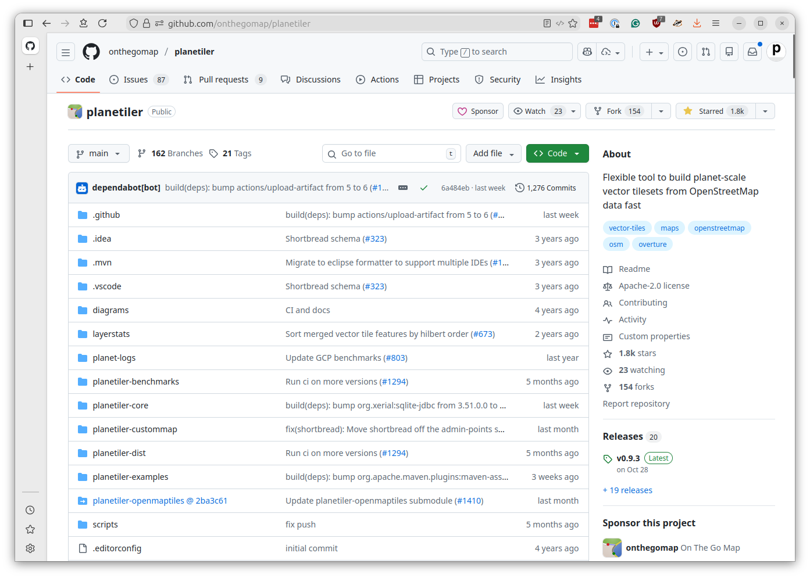

# Building the basemap

Now that we have configured our AWS account and learned how to create custom EC2 runners with GitHub Actions, we're ready to put everything together and build our global basemap.

To do that, we'll need to take advantage of another open-source tool.

## What is Planetiler?

[Planetiler](https://github.com/onthegomap/planetiler) is an open-source Java application that can convert massive amounts of geographic data into the PMTiles file format. It was created by [Michael Barry](https://github.com/msbarry), who designed it to be capable of processing the entire OpenStreetMap planet file in just a few hours.



The tool offers [extensive configuration options](https://github.com/onthegomap/planetiler/blob/main/config-example.properties) that control which map features are included, how they are handled at different zoom levels and other settings. That makes it possible to create different types of maps optimized for different use cases. Some developers use it to create highly customized maps limited to small areas, while others, like us, use it to create general-purpose basemaps of the entire world.

## Why we need EC2

In the last chapter, we created a simple Action that ran on a custom EC2 server. Now we're going to put that pattern to work.

GitHub's standard Actions runners have fairly limited resources, and they're not allowed to run longer than six hours. While that might be suitable for most tasks, it's simply not enough power for this job.

Planetiler needs lots of RAM to efficiently process the full planet file, multiple high-speed CPUs to parallelize the work and hundreds of gigabytes of fast disk space for temporary files. Given enough resources, it can complete map out the planet in a few hours, but on a small server that same task could take days or even weeks.

## Creating the Planetiler workflow

Let's start by creating a new workflow file that will build our basemap files. Create a new file in your repository called `.github/workflows/build-planetiler.yaml`.

We'll start with the familiar pattern from the previous chapter and gradually add the Planetiler-specific features.

### Step 1: Basic structure with product choice

First, let's set up the basic workflow structure. This time, we'll add a new feature: a choice input that allows you to select what type of map to build.

```yaml
name: Build Planetiler

on:
  workflow_dispatch:
    inputs:
      product:
        description: 'Product to build'
        required: true
        type: choice
        options:
          - base        # A basemap without buildings and with more aggressive simplification
          - buildings  # A buildings-only layer with minimal simplification
```

The `choice` type creates a dropdown menu in the GitHub Actions interface. We're offering two options:

* **base**: A complete basemap without building footprints, using aggressive simplification to keep file sizes smaller
* **buildings**: A layer containing only building footprints with minimal simplification to preserve detail

This pattern allows you to generate different map products from the same workflow, each optimized for different use cases.

### Step 2: Environment configuration

Next, add the environment variables that configure our AWS and EC2 settings. You should customize these values to match your AWS setup from the previous chapter.

```yaml
# Customize these values for your environment
env:
  # AWS
  AWS_REGION: us-east-1
  AWS_SUBNET_ID: subnet-04b767d962c0efdff
  AWS_SECURITY_GROUP_ID: sg-0fe118aaf037afaa2
  AWS_S3_BUCKET_NAME: first-basemap

  # EC2
  EC2_IMAGE_ID: ami-0e86e20dae9224db8   # Ubuntu 24.04 LTS
  EC2_INSTANCE_TYPE: r5d.8xlarge        # 32 vCPUs, 256 GB RAM, 2x600 GB NVMe SSD
  EC2_VOLUME_SIZE: 1000                 # Root volume size in GB
```

Replace `AWS_SUBNET_ID` and `AWS_SECURITY_GROUP_ID` with the values you saved in the previous chapter. The `AWS_S3_BUCKET_NAME` should be a unique name for your bucket — we'll use this to store and serve the finished map tiles.

The `EC2_INSTANCE_TYPE` is set to `r5d.8xlarge`, which is a memory-optimized instance with NVMe storage. The `d` in the name indicates it includes instance storage, which we'll use for faster processing. The `EC2_VOLUME_SIZE` of 1000 GB provides plenty of space for downloading and processing the OpenStreetMap data.

### Step 3: Concurrency control

Add a concurrency section to ensure only one build runs at a time for each product:

```yaml
concurrency:
  group: ${{ github.workflow }}-${{ github.ref }}-${{ inputs.product }}
  cancel-in-progress: true
```

This configuration creates a unique concurrency group based on the workflow name, the git reference (branch), and the product being built. If you start a new build while one is already running, the old one will be canceled automatically. This prevents wasting money on outdated builds.

### Step 4: The start-runner job

Now let's create the first job, which starts our EC2 runner. This should look familiar from the previous chapter, with some important additions:

```yaml
jobs:
  start-runner:
    name: Start self-hosted EC2 runner
    runs-on: ubuntu-latest
    outputs:
      label: ${{ steps.start-ec2-runner.outputs.label }}
      ec2-instance-id: ${{ steps.start-ec2-runner.outputs.ec2-instance-id }}
    steps:
      - name: Configure AWS credentials
        uses: aws-actions/configure-aws-credentials@v5
        with:
          aws-access-key-id: ${{ secrets.AWS_ACCESS_KEY_ID }}
          aws-secret-access-key: ${{ secrets.AWS_SECRET_ACCESS_KEY }}
          aws-region: ${{ env.AWS_REGION }}

      - name: Start EC2 runner
        id: start-ec2-runner
        uses: machulav/ec2-github-runner@v2.4.2
        with:
          mode: start
          github-token: ${{ secrets.GH_PERSONAL_ACCESS_TOKEN }}
          ec2-image-id: ${{ env.EC2_IMAGE_ID }}
          ec2-instance-type: ${{ env.EC2_INSTANCE_TYPE }}
          ec2-volume-size: ${{ env.EC2_VOLUME_SIZE }}
          subnet-id: ${{ env.AWS_SUBNET_ID }}
          security-group-id: ${{ env.AWS_SECURITY_GROUP_ID }}
          pre-runner-script: |
            # Update system
            sudo apt-get update -y

            # Install required packages
            sudo apt-get install -y git libicu-dev unzip curl nvme-cli openjdk-21-jdk-headless

            # Download and install AWS CLI v2
            curl "https://awscli.amazonaws.com/awscli-exe-linux-x86_64.zip" -o "awscliv2.zip"
            unzip awscliv2.zip
            sudo ./aws/install

            # Clean up installation files
            rm -rf aws awscliv2.zip

            # Setup NVMe instance storage
            if lsblk | grep -q nvme1n1; then
              sudo mkfs.xfs /dev/nvme1n1
              sudo mkdir -p /mnt/planetiler
              sudo mount /dev/nvme1n1 /mnt/planetiler
              sudo chmod 777 /mnt/planetiler
            fi
```

The pre-runner script now includes several additions specific to Planetiler:

* **openjdk-21-jdk-headless**: Planetiler is a Java application, so we need the Java Development Kit
* **AWS CLI**: We'll use this to upload the finished tiles to S3
* **NVMe setup**: The `r5d.8xlarge` instance includes fast NVMe storage at `/dev/nvme1n1`. We format it as XFS, mount it at `/mnt/planetiler`, and make it writable. This gives us much faster disk I/O than the standard EBS volume.

### Step 5: The generate-tiles job

Now comes the main event: the job that actually generates the map tiles. This job has several steps that build up gradually.

First, the job configuration:

```yaml
  generate-tiles:
    name: Generate tiles
    needs: start-runner
    runs-on: ${{ needs.start-runner.outputs.label }}
    timeout-minutes: 240  # Four hours
    steps:
      - name: Configure AWS credentials
        uses: aws-actions/configure-aws-credentials@v5
        with:
          aws-access-key-id: ${{ secrets.AWS_ACCESS_KEY_ID }}
          aws-secret-access-key: ${{ secrets.AWS_SECRET_ACCESS_KEY }}
          aws-region: ${{ env.AWS_REGION }}
```

The `needs: start-runner` tells GitHub Actions to wait for the first job to complete before starting this one. The `runs-on` uses the label from the EC2 runner we just started. The `timeout-minutes` is set to 240 (four hours), which should be enough time for Planetiler to process the planet file.

#### Configuring parameters

The first step configures the simplification parameters based on which product was selected:

```yaml
      - name: Configure parameters
        run: |
          # Set simplification parameters based on selected profile
          case "${{ inputs.product }}" in
            'buildings')
              echo "Using the default simplification profile for a building layer"
              SIMPLIFY_TOLERANCE="0.1"
              SIMPLIFY_TOLERANCE_MAX_ZOOM="0.0625"
              MIN_FEATURE_SIZE="1.0"
              MIN_FEATURE_SIZE_MAX_ZOOM="0.0625"
              MIN_ZOOM=13
              MAX_ZOOM=15
              ;;
            'base')
              echo "Using a more aggressive simplification profile for a base map layer without buildings"
              SIMPLIFY_TOLERANCE="0.4"
              SIMPLIFY_TOLERANCE_MAX_ZOOM="0.3"
              MIN_FEATURE_SIZE="1.5"
              MIN_FEATURE_SIZE_MAX_ZOOM="0.5"
              MIN_ZOOM=0
              MAX_ZOOM=15
              ;;
             *)
              echo "Error: Unknown product '${{ inputs.product }}'"
              exit 1
              ;;
          esac

          # Export to GitHub environment for next steps
          echo "SIMPLIFY_TOLERANCE=$SIMPLIFY_TOLERANCE" >> $GITHUB_ENV
          echo "SIMPLIFY_TOLERANCE_MAX_ZOOM=$SIMPLIFY_TOLERANCE_MAX_ZOOM" >> $GITHUB_ENV
          echo "MIN_FEATURE_SIZE=$MIN_FEATURE_SIZE" >> $GITHUB_ENV
          echo "MIN_FEATURE_SIZE_MAX_ZOOM=$MIN_FEATURE_SIZE_MAX_ZOOM" >> $GITHUB_ENV
          echo "MIN_ZOOM=$MIN_ZOOM" >> $GITHUB_ENV
          echo "MAX_ZOOM=$MAX_ZOOM" >> $GITHUB_ENV

          # Display simplification parameters
          echo ""
          echo "=== Simplification Parameters ==="
          echo "Simplify tolerance: $SIMPLIFY_TOLERANCE"
          echo "Simplify tolerance at max zoom: $SIMPLIFY_TOLERANCE_MAX_ZOOM"
          echo "Min feature size: $MIN_FEATURE_SIZE"
          echo "Min feature size at max zoom: $MIN_FEATURE_SIZE_MAX_ZOOM"
          echo "Min zoom: $MIN_ZOOM"
          echo "Max zoom: $MAX_ZOOM"
          echo "===================="
```

This uses a bash `case` statement to set different parameters based on the product choice. Let's understand what these parameters control:

* **SIMPLIFY_TOLERANCE**: How much to simplify line geometries (higher = more simplification)
* **MIN_FEATURE_SIZE**: Minimum size in tile pixels for features to appear (higher = fewer small features)
* **MIN_ZOOM/MAX_ZOOM**: The range of zoom levels to generate

For the base map, we use aggressive simplification (0.4 vs 0.1) and generate all zoom levels from 0 to 15. For buildings, we use minimal simplification and only generate zooms 13-15 where buildings are visible.

The variables are exported to `$GITHUB_ENV`, which makes them available to all subsequent steps in the job.

#### Downloading Planetiler

Next, we download the latest version of Planetiler from GitHub:

```yaml
      - name: Download Planetiler
        working-directory: /mnt/planetiler
        run: |
          echo "Downloading latest Planetiler..."

          # Scrape latest release download URL from GitHub API
          LATEST_URL=$(curl -s https://api.github.com/repos/onthegomap/planetiler/releases/latest \
            | grep browser_download_url | head -1 | grep -E "planetiler.jar" | cut -d '"' -f 4)
          echo "Download URL: $LATEST_URL"

          # Download Planetiler JAR
          curl -L -o planetiler.jar "$LATEST_URL"

          # Verify download
          java -jar planetiler.jar --help > /dev/null
          echo "✓ Planetiler downloaded successfully"
```

The `working-directory: /mnt/planetiler` tells this step to run in our fast NVMe storage directory. We use the GitHub API to find the latest release, extract the download URL, and download the JAR file. The verification step runs `--help` to make sure Java can execute it properly.

#### Generating the tiles

Now comes the core step that actually generates the map tiles:

```yaml
      - name: Generate PMTiles file
        working-directory: /mnt/planetiler
        run: |
          TIMESTAMP=$(date +%Y%m%d-%H%M%S)
          OUTPUT_FILE="planet-${TIMESTAMP}-${{ inputs.product }}.pmtiles"

          # Build Planetiler command, starting with Java invocation and configuration of memory
          PLANETILER_CMD="java -Xmx200g -XX:MaxHeapFreeRatio=40 -jar planetiler.jar"

          # Configure data source
          PLANETILER_CMD="$PLANETILER_CMD --area=planet --bounds=world --download"
          PLANETILER_CMD="$PLANETILER_CMD --download-threads=10 --download-chunk-size-mb=1000"

          # Limit languages to English for smaller size
          PLANETILER_CMD="$PLANETILER_CMD --languages=en"

          # Add simplification parameters
          PLANETILER_CMD="$PLANETILER_CMD --simplify-tolerance=$SIMPLIFY_TOLERANCE"
          PLANETILER_CMD="$PLANETILER_CMD --simplify-tolerance-at-max-zoom=$SIMPLIFY_TOLERANCE_MAX_ZOOM"
          PLANETILER_CMD="$PLANETILER_CMD --min-feature-size=$MIN_FEATURE_SIZE"
          PLANETILER_CMD="$PLANETILER_CMD --min-feature-size-at-max-zoom=$MIN_FEATURE_SIZE_MAX_ZOOM"

          # Add remaining options
          PLANETILER_CMD="$PLANETILER_CMD --fetch-wikidata"
          PLANETILER_CMD="$PLANETILER_CMD --output=$OUTPUT_FILE"
          PLANETILER_CMD="$PLANETILER_CMD --nodemap-type=array"
          PLANETILER_CMD="$PLANETILER_CMD --storage=ram"
          PLANETILER_CMD="$PLANETILER_CMD --min-zoom=$MIN_ZOOM"
          PLANETILER_CMD="$PLANETILER_CMD --max-zoom=$MAX_ZOOM"

          # Skip building merge if requested
          if [ "${{ inputs.product }}" == "base" ]; then
            PLANETILER_CMD="$PLANETILER_CMD --building-merge-z13=false"
          fi

          # Set feature layers based on product
          if [ "${{ inputs.product }}" == "buildings" ]; then
            PLANETILER_CMD="$PLANETILER_CMD --only-layers=building"
          else
            PLANETILER_CMD="$PLANETILER_CMD --exclude-layers=housenumber,building,poi"
          fi

          echo ""
          echo "=== Starting Planetiler ==="
          echo "Command: $PLANETILER_CMD"
          echo "==========================="
          echo ""

          # Run Planetiler
          $PLANETILER_CMD 2>&1 | tee planetiler.log

          # Verify output
          if [ ! -f "$OUTPUT_FILE" ]; then
            echo "✗ Output file not created"
            exit 1
          fi

          FILE_SIZE=$(stat -c%s "$OUTPUT_FILE")
          if [ "$FILE_SIZE" -lt 1000000 ]; then
            echo "✗ Output file too small (${FILE_SIZE} bytes) - generation likely failed"
            tail -100 planetiler.log
            exit 1
          fi

          echo "✓ Planet tiles generated successfully!"
          ls -lh "$OUTPUT_FILE"
          echo "OUTPUT_FILE=$OUTPUT_FILE" >> $GITHUB_ENV
```

This is a complex step, so let's break it down:

1. **Output file naming**: We create a timestamped filename like `planet-20251221-143052-buildings.pmtiles`

2. **Java configuration**: `-Xmx200g` sets the maximum heap size to 200 GB. This is crucial for performance. `-XX:MaxHeapFreeRatio=40` helps manage memory more efficiently.

3. **Data source**: `--area=planet --bounds=world --download` tells Planetiler to download the entire planet file from OpenStreetMap's servers.

4. **Download optimization**: `--download-threads=10` uses 10 parallel connections, and `--download-chunk-size-mb=1000` downloads in 1 GB chunks for efficiency.

5. **Language limiting**: `--languages=en` includes only English names to reduce file size. You could add more with `--languages=en,es,fr`.

6. **Storage mode**: `--storage=ram` keeps intermediate data in memory rather than on disk, which is much faster on our high-memory instance.

7. **Layer selection**: For buildings, we use `--only-layers=building`. For the base map, we exclude buildings, house numbers, and POIs with `--exclude-layers`.

8. **Logging and verification**: We pipe all output to both the console and a log file using `tee`. After Planetiler finishes, we verify the output file exists and is larger than 1 MB (a simple sanity check).

#### Setting up S3

Before we can upload our tiles, we need to ensure the S3 bucket exists and is configured correctly:

```yaml
      - name: Ensure S3 bucket exists
        run: |
          BUCKET="${{ env.AWS_S3_BUCKET_NAME }}"

          if ! aws s3api head-bucket --bucket "$BUCKET" 2>/dev/null; then
            echo "Creating bucket $BUCKET..."
            if [ "${{ env.AWS_REGION }}" = "us-east-1" ]; then
              aws s3api create-bucket --bucket "$BUCKET"
            else
              aws s3api create-bucket \
                --bucket "$BUCKET" \
                --create-bucket-configuration LocationConstraint=${{ env.AWS_REGION }}
            fi
            echo "✓ Bucket created"
          else
            echo "✓ Bucket already exists"
          fi

          # Disable Block Public Access
          echo "Configuring public access settings..."
          aws s3api put-public-access-block \
            --bucket "$BUCKET" \
            --public-access-block-configuration \
            "BlockPublicAcls=false,IgnorePublicAcls=false,BlockPublicPolicy=false,RestrictPublicBuckets=false"

          # Add public read policy
          echo "Applying public read policy..."
          cat > /tmp/bucket-policy.json << EOF
          {
            "Version": "2012-10-17",
            "Statement": [
              {
                "Sid": "PublicReadGetObject",
                "Effect": "Allow",
                "Principal": "*",
                "Action": "s3:GetObject",
                "Resource": "arn:aws:s3:::${BUCKET}/*"
              }
            ]
          }
          EOF

          aws s3api put-bucket-policy --bucket "$BUCKET" --policy file:///tmp/bucket-policy.json
          echo "✓ Public access configured"

          # Add CORS configuration
          echo "Configuring CORS..."
          cat > /tmp/cors.json << EOF
          {
            "CORSRules": [{
              "AllowedOrigins": ["*"],
              "AllowedMethods": ["GET", "HEAD"],
              "AllowedHeaders": ["*"],
              "MaxAgeSeconds": 3600
            }]
          }
          EOF
          aws s3api put-bucket-cors --bucket "$BUCKET" --cors-configuration file:///tmp/cors.json
          echo "✓ CORS configured"
```

This step does several important things:

1. **Bucket creation**: Checks if the bucket exists, and creates it if not. Note that `us-east-1` requires special handling — it doesn't use a `LocationConstraint`.

2. **Public access**: Disables AWS's block public access settings and adds a bucket policy that allows anyone to read files. This is necessary for the map to be accessible from web browsers.

3. **CORS configuration**: Enables Cross-Origin Resource Sharing, which allows web pages from different domains to access the tiles.

#### Uploading to S3

Finally, we upload the finished tiles:

```yaml
      - name: Upload to S3 bucket
        working-directory: /mnt/planetiler
        run: |
          S3_PATH="s3://${{ env.AWS_S3_BUCKET_NAME }}/${OUTPUT_FILE}"
          echo "Uploading to: $S3_PATH"

          # Upload with metadata and caching headers, which will tell CDNs to cache for 1 day
          aws s3 cp "$OUTPUT_FILE" "$S3_PATH" \
            --storage-class INTELLIGENT_TIERING \
            --cache-control "public, max-age=86400" \
            --metadata "github-run=${{ github.run_id }},product=${{ inputs.product }}" \
            --no-progress

          echo "✓ Upload complete!"
          echo "Public URL: https://${{ env.AWS_S3_BUCKET_NAME }}.s3.amazonaws.com/${OUTPUT_FILE}"
```

The upload includes:

* **INTELLIGENT_TIERING**: This S3 storage class automatically moves files between access tiers based on usage patterns, optimizing costs
* **cache-control**: Sets the max-age to 86400 seconds (1 day), which tells browsers and CDNs to cache the tiles
* **metadata**: Tags the file with the GitHub run ID and product type for tracking
* **Public URL**: Prints the URL where the tiles can be accessed

### Step 6: The stop-runner job

Finally, we need to shut down the EC2 instance:

```yaml
  stop-runner:
    name: Stop self-hosted EC2 runner
    needs:
      - start-runner
      - generate-tiles
    runs-on: ubuntu-latest
    if: ${{ always() }}
    steps:
      - name: Configure AWS credentials
        uses: aws-actions/configure-aws-credentials@v5
        with:
          aws-access-key-id: ${{ secrets.AWS_ACCESS_KEY_ID }}
          aws-secret-access-key: ${{ secrets.AWS_SECRET_ACCESS_KEY }}
          aws-region: ${{ env.AWS_REGION }}

      - name: Stop EC2 runner
        uses: machulav/ec2-github-runner@v2.4.2
        with:
          mode: stop
          github-token: ${{ secrets.GH_PERSONAL_ACCESS_TOKEN }}
          label: ${{ needs.start-runner.outputs.label }}
          ec2-instance-id: ${{ needs.start-runner.outputs.ec2-instance-id }}
```

The `if: ${{ always() }}` clause ensures this job runs whether the tile generation succeeded or failed. This is critical — you don't want to leave an expensive EC2 instance running if something goes wrong!

## Running the workflow

Once you've saved the complete workflow file to `.github/workflows/build-planetiler.yaml`, commit it to your repository. Then navigate to the Actions tab and you should see "Build Planetiler" in the list of workflows.

Click on the workflow name, then click "Run workflow" in the upper right. You'll see a dropdown where you can choose which product to build:

* Select "buildings" for a buildings-only layer
* Select "base" for a complete basemap without buildings

Click the green "Run workflow" button to start the process. The workflow will:

1. Start the EC2 instance (takes about 2-3 minutes)
2. Download Planetiler and the planet file (takes about 10-30 minutes depending on network speed)
3. Process the data and generate tiles (takes about 2-3 hours for the full planet)
4. Upload the tiles to S3 (takes about 5-15 minutes depending on file size)
5. Stop the EC2 instance

You can monitor the progress in the Actions tab. The logs will show you exactly what Planetiler is doing at each stage.

## Cost considerations

Running this workflow will incur AWS costs:

* **EC2**: An `r5d.8xlarge` instance costs about $2.88 per hour in us-east-1. A typical run takes 3-4 hours, so expect about $10-12 per build.
* **S3 storage**: The finished PMTiles file will be 50-100 GB depending on your configuration. S3 standard storage costs $0.023 per GB per month, so about $1-2/month for storage.
* **S3 bandwidth**: The first 100 GB of data transfer out is free each month. After that, it costs about $0.09 per GB.
* **Data transfer**: Downloading the planet file from OpenStreetMap is free, but it's about 70 GB of data.

For occasional builds, the total cost is quite reasonable — probably $15-20/month if you rebuild once a week. That's much cheaper than commercial mapping services at scale.

## Next steps

Now that you have a working Planetiler workflow, you can customize it in many ways:

* Adjust the zoom levels to generate more or less detail
* Add more languages to the `--languages` parameter
* Change the simplification parameters to balance file size vs. detail
* Add custom data sources beyond OpenStreetMap
* Generate tiles for specific regions instead of the entire planet

In the next chapter, we'll learn how to display these tiles in an interactive web map using MapLibre GL JS.
