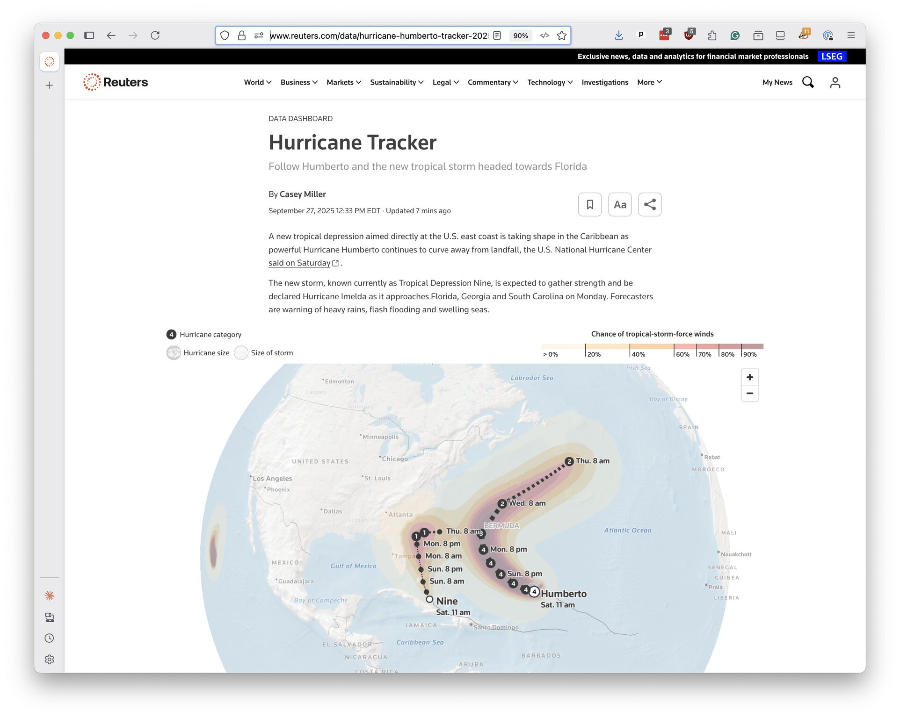

# What you will make

If you work through this class, you will create an interactive map of the world that can display whatever data you'd like.

This type of map is often called a "basemap" because it provides a foundation for displaying data layers like weather conditions, election results, demographics or the location of newsworthy events.

Here's an example of the basemap you will make displayed using the [MapLibre GL](https://maplibre.org/) JavaScript library and the [OSM Liberty](https://github.com/maputnik/osm-liberty) styles released by [Maputnik](https://maputnik.github.io/).

```{raw} html
<div style="width: 100%; height: 400px; position: relative;">
    <div id="demo-map" style="position: absolute; top: 0; bottom: 0; left: 0; right: 0;"></div>
</div>
<script src="https://unpkg.com/maplibre-gl@5.15.0/dist/maplibre-gl.js"></script>
<script src="https://unpkg.com/pmtiles@3/dist/pmtiles.js"></script>
<link href="https://unpkg.com/maplibre-gl@5.15.0/dist/maplibre-gl.css" rel="stylesheet">
<script>
    // Register PMTiles protocol with MapLibre
    let protocol = new pmtiles.Protocol();
    maplibregl.addProtocol('pmtiles', protocol.tile);

    // Create the map
    const map = new maplibregl.Map({
        container: 'demo-map',
        style: '_static/style.json',
        center: [-98.5795, 25],
        zoom: 1.5,
        minZoom: 1,
        maxZoom: 15,
        attributionControl: false,
        projection: { type: 'globe' }
    });

   // Globe rotation
    function createGlobeSpinner(map, degreesPerSecond = 10) {
        let animationId = null;
        let lastTime;

        function spin() {
            const now = performance.now();
            const elapsed = (now - lastTime) / 1000;
            lastTime = now;

            const center = map.getCenter();
            center.lng += degreesPerSecond * elapsed;
            map.setCenter(center);

            animationId = requestAnimationFrame(spin);
        }

        return {
            start() {
                if (!animationId) {
                    lastTime = performance.now();
                    spin();
                }
            },
            stop() {
                if (animationId) {
                    cancelAnimationFrame(animationId);
                    animationId = null;
                }
            }
        };
    }

    // Start spinning once the map is ready
    map.on('load', () => {
        map.setProjection({ type: 'globe' });

        const spinner = createGlobeSpinner(map);
        spinner.start();

        // Optional: pause on user interaction, resume after
        map.on('mousedown', () => spinner.stop());
        map.on('touchstart', () => spinner.stop());
        map.on('mouseup', () => spinner.start());
        map.on('touchend', () => spinner.start());
    });
</script>
```

Until recently, creating a basemap was a difficult task that required specialized skills and expensive servers. Rather than take on the challenge, many organizations chose to pay for access to commercial mapping services, which can be costly for applications that draw a lot of traffic.

Then open-source software changed the equation.

The new [PMTiles](https://github.com/protomaps/PMTiles) file format allowed for the massive database needed to render a detailed map of the world to be stored and served efficiently from a single file.

That meant you no longer need a complex, fragile cloud service to render maps. Thanks to PMTiles, all it takes to escape an expensive mapping contract is to convert the free-and-open [OpenStreetMap](https://www.openstreetmap.org/) database to the new format.

Best of all, because the map is stored as a single static file, it requires no maintenance. There are no databases to patch, no servers to upgrade, no dependencies to update. Upload the file once and it works indefinitely.

This class will show you how you can do just that using open-source tools and cheap cloud-computing services. Once you're done, your only ongoing cost will be hosting files on [Amazon S3](https://aws.amazon.com/s3/) or a competitor service, which can be done for just a few dollars a month.

The code we'll work through was initially developed in 2025 for [Reuters](https://www.reuters.com/), the world's largest multimedia news provider. The newsroom uses it as the foundation for publishing its data-driven journalism. For instance, Reuters journalist [Casey Miller](https://www.reuters.com/authors/casey-miller/) has used it to create interactive maps that track hurricane activity around the world.



```{note}
The development of Reuters basemap was led by [Scott Reinhard](https://scottreinhardmaps.com/), who has written a detailed explanation of his design process [on his blog](). While the fonts, styles and other customizations he tailored for Reuters are copyrighted, the underlying techniques are free for anyone to adapt.
```

It will take a lot of different tools to get the job done, but none of them are difficult to use and we'll proceed slowly, step-by-step. Ready?
